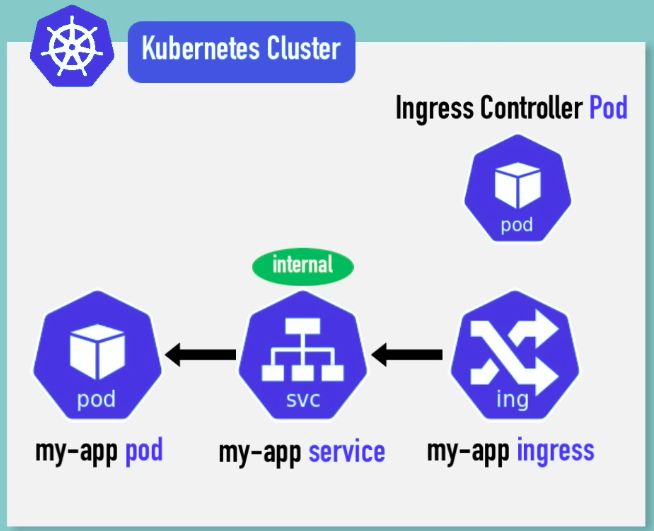
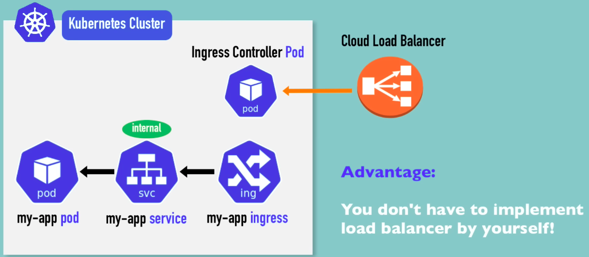
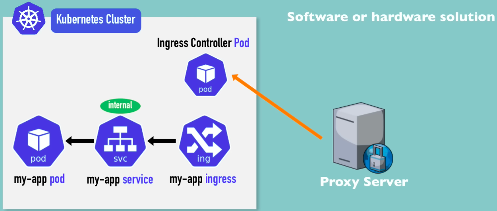
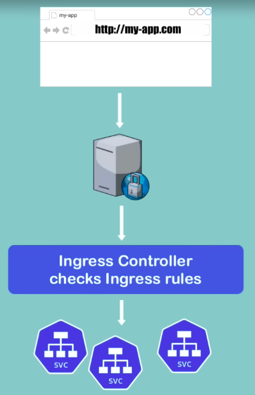
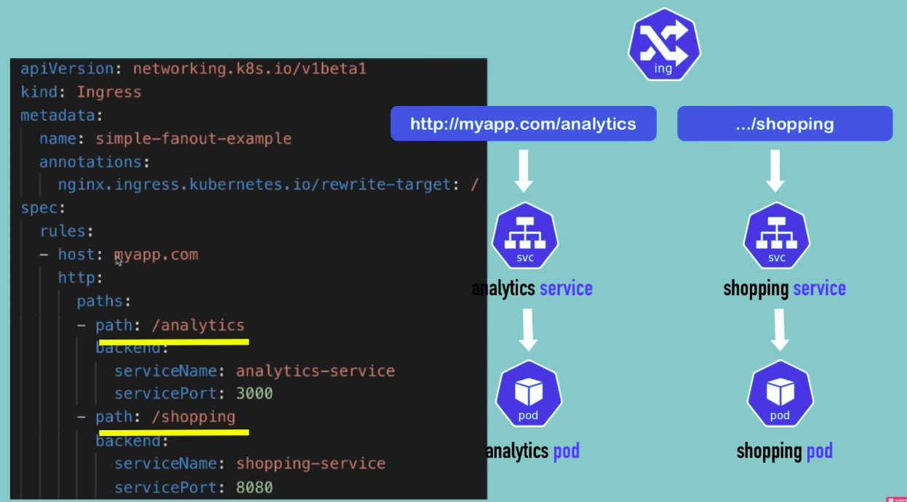
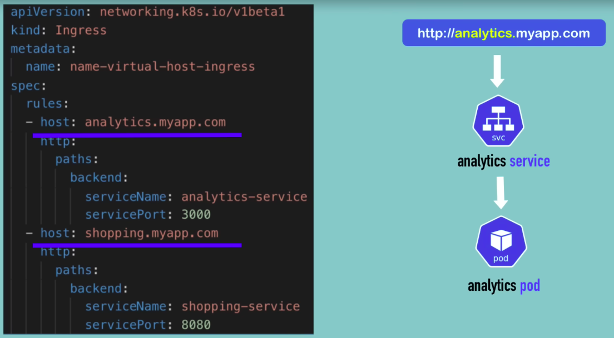
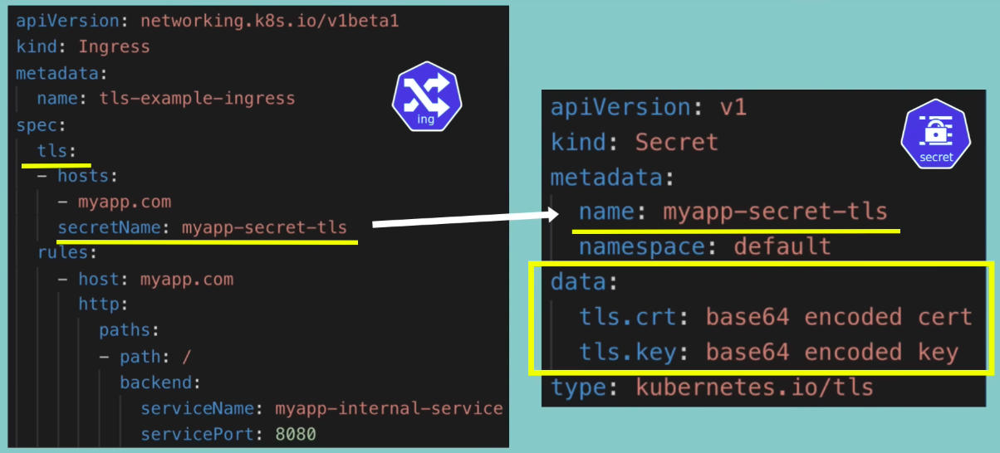

## Ingress

### What is Ingress?
- Routes external traffic to internal services using domain names.
- Replaces external IPs and ports with readable URLs.

### Ingress Controller
- Evaluates Ingress rules (e.g., Nginx Ingress Controller).
- Must be installed in the cluster.
- <left></left>

- In case of Cloud Provider LoadBalancer:

  - <left></left>

- In case of Bare Metal VM:

  - <left></left>

  - <left></left>

### Example Ingress Rule

```yaml
apiVersion: networking.k8s.io/v1
kind: Ingress
metadata:
  name: dashboard-ingress
spec:
  rules:
  - host: dashboard.com
    http:
      paths:
        backend:
          serviceName: kubernetes-dashboard
          servicePort: 80
```

- In Above file:
  - **host**:
    -  should be a valid domain.
    - map domain name to Node's IP Address, which is entry-point.
  - **http**: means, take all the web requests.
  - **paths**: match the URL path, by default all.
  - **backend**: name & port of the service, which connects the application pod to the service.


---

### Different Use-case

- Multiple Path for same Host

  - <left></left>

- Multiple sub-domain for same host

  - <left></left>

---

### Configuring TLS certificate - https//

<left></left>

- Data keys need to be "**tls.crt**" and "**tls.key**".

- Values are **file content**, NOT file paths/locations.

- Secret component must be in the same namespace as the Ingress Component.

  
