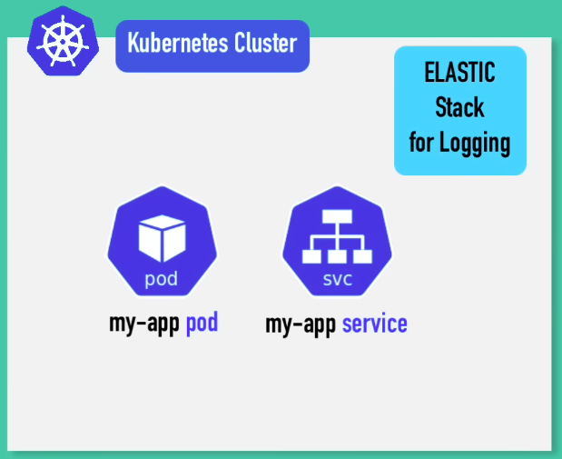
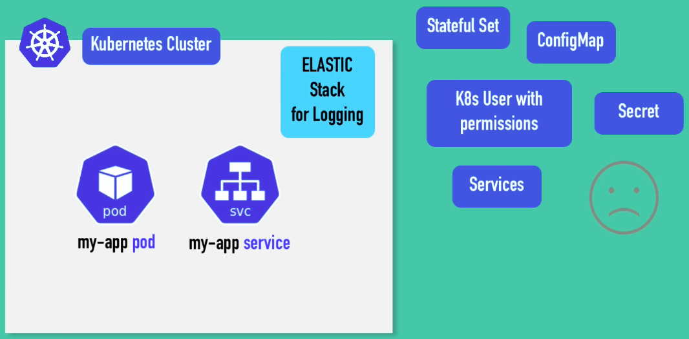
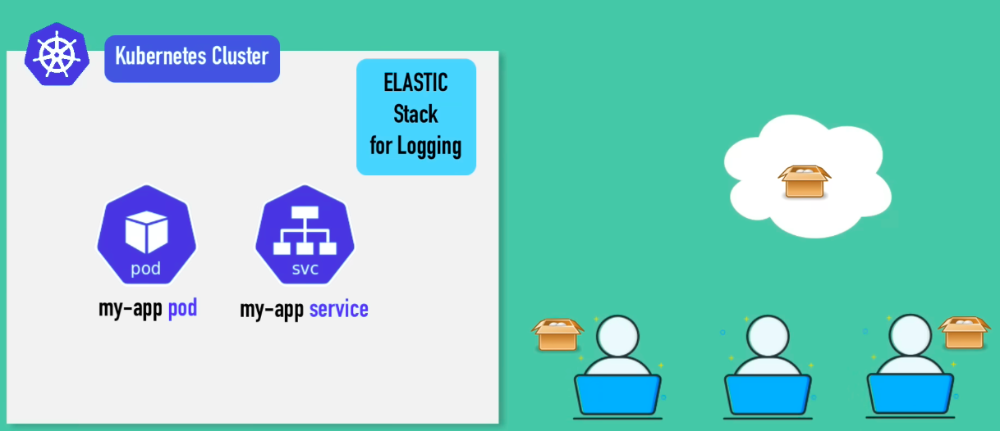
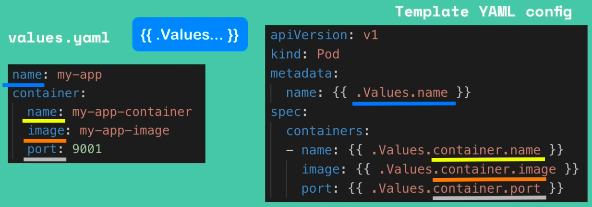

## Helm

### What is Helm?

- **Package manager** for Kubernetes
  - to package YAML files  and distribute them in public and private registry.

- Templating Engine

---

### As a Package Manager

- Suppose you want to have ELK stack in your cluster

  - <left></left>

- You'll need additional configuration, which will take time and effort

  - <left></left>

- In to save time and just install those YAML files, we use Helm Chart

  - <left></left>

  

---

### Generating a Helm Chart

You can create the folder structure and files for a basic Helm template using the **`helm create <chart-name>`** command. This generates scaffolding that can then be customized.

---

### Folder Structure

A generated Helm chart typically includes:

- **charts/**: This folder is used for any dependencies on other Helm charts.
- **templates/**: This is where most of your Kubernetes manifest files will reside.
- **charts.yaml**: Contains metadata about your Helm chart, such as its name and version number.
- **values.yaml**: Defines the default configuration values for your Helm chart. These values can be customized.
- **helmignore**: Specifies files to ignore when packaging the Helm chart.

------

## Deploying a Basic Helm Application

1. **Prepare Manifest Files**: Start with your standard Kubernetes manifest files (e.g., deployment, service, config map).
2. **Install the Helm Chart**: Navigate to the parent folder of your Helm chart and run **`helm install <release-name> <chart-location>`** to deploy your application.
3. **Verify Deployment**: Use **`kubectl get all`** to confirm that all resources (pods, load balancer, deployment, replica set) have been created.
4. **Test the Application**: If using Minikube, you can use `minikube tunnel` to tunnel traffic to your load balancer and then access the application via `curl localhost:80` or a web browser.

------

## Helm Templating for Customisation

- **Identifying Redundancies**: Kubernetes manifest files often have repetitive elements (e.g., names, labels) that are ideal candidates for templating.
- **Defining Values**: In `values.yaml`, define key-value pairs for customizable parameters. For example, `app_name: myHelmApp`.
- **Applying Templates**: In your Kubernetes manifest files, use `{{ .Values.<parameter-name> }}` to inject values from `values.yaml`.

  - <left></left>

- **Upgrading a Release**: After making changes, upgrade your Helm release using `helm upgrade <release-name> <chart-location> --values <path-to-values.yaml>`.
- **Dynamic Information in Notes**: You can create a `notes.txt` file in your `templates` folder to output configuration information to the user upon installation or upgrade. This file can also be templated to display dynamic values.

------

## Environment-Specific Deployments

- **Creating Separate Values Files**: To manage different configurations for various environments, create separate `values` files (e.g., `values-dev.yaml`, `values-prod.yaml`).
- **Overriding Default Values**: Values defined in environment-specific files will override the corresponding values in the default `values.yaml`.
- **Deploying to Specific Namespaces**: When deploying, specify the namespace for the Helm release using the `-n` flag (e.g., `helm install <release-name> <chart-location> -f values-dev.yaml -n dev`).
- **Verifying Environment Deployments**: Use `helm ls --all-namespaces` to see all releases and `kubectl get all -n <namespace>` to check resources in a specific namespace.