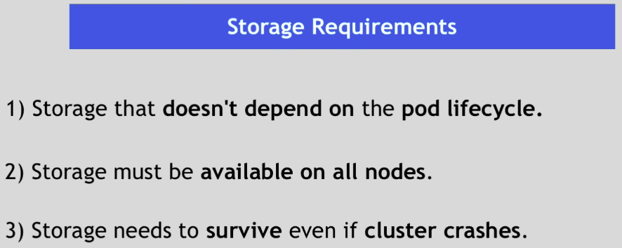
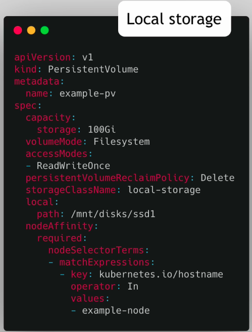
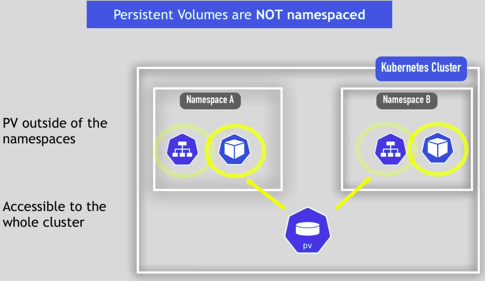
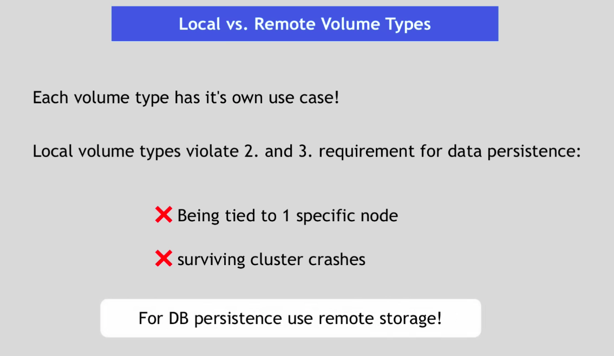
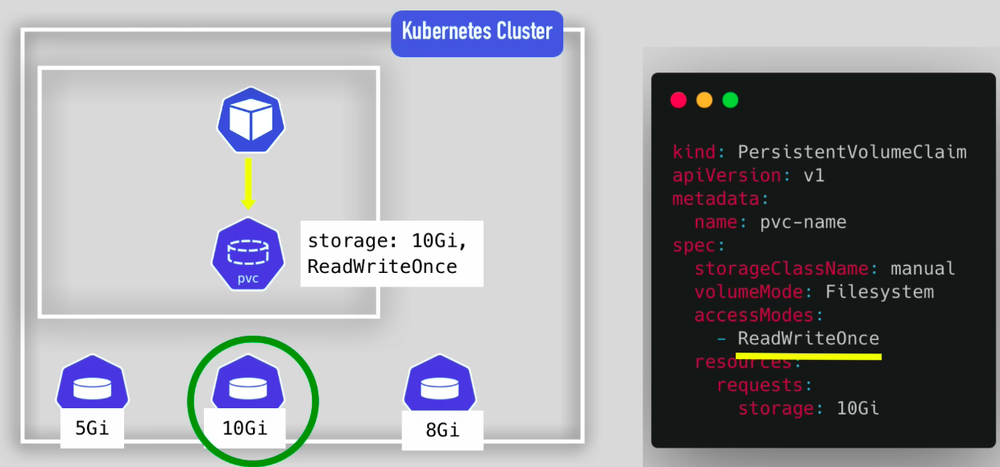
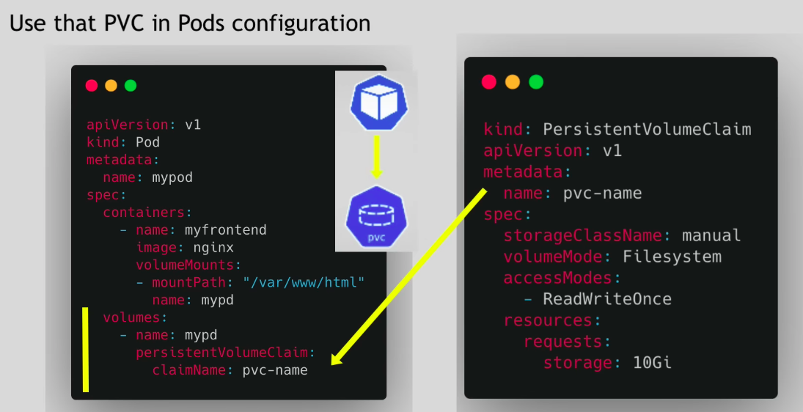
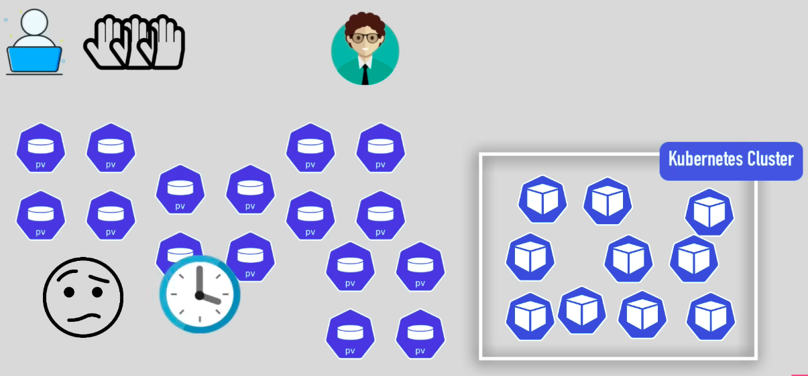
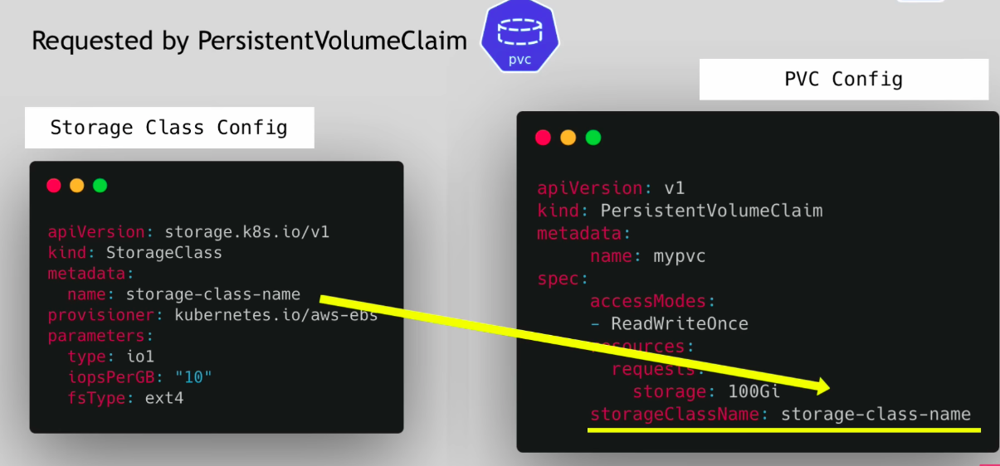
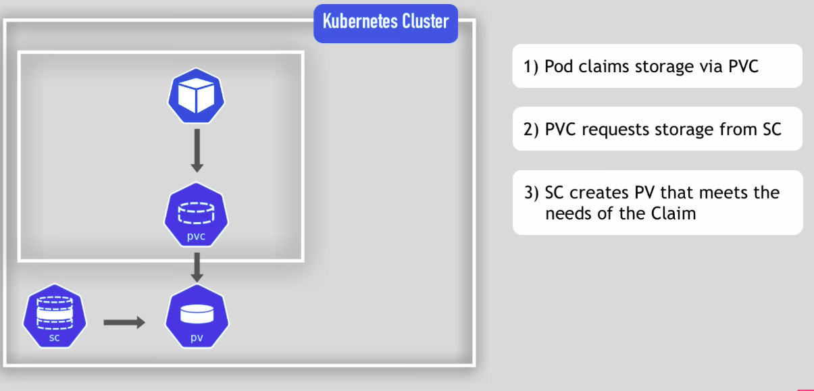

# Volumes

used to persist data in kubernetes

- Data persistence is not present out-of-box in kubernetes(when a Pod restarts, it'll not have data backup,it's ephemeral)

- <left></left>

#### Persistent Volume

Actual abstraction that creates a volume

- Depending on the storage type, spec differs

- <left></left>

- <left></left>

- <left></left>

---

#### Persistent Volume Claim

Pod will access the claim, claim in-turn will see which volume satisfies needs and pick the volume

- <left></left>

- <left></left>

- Flow:

  - Pod requests the volume through the Claim
  - Claim tries to find  a volume in the Cluster
  - Volume has the actual storage backend
  - Volume is mounted to Pod
  - Volume is then mounted to Container
  - Now the Container is able to read/write into storage
  - If the Pod crashes & restarts, the stored data will still remain in volume 

- Note:

  - Claim must be in same namespace as Pod using the Claim

---

#### Storage Class

- Volumes has to be manually created by Admin of cluster
  - this can be tedious 
  - and time consuming

- <left></left>

- To tackle this, we use Storage Class

  - This abstracts Storage provider

- <left></left>

- <left></left>

  